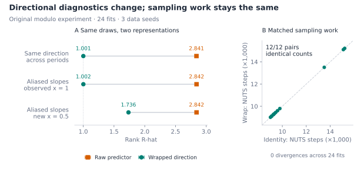
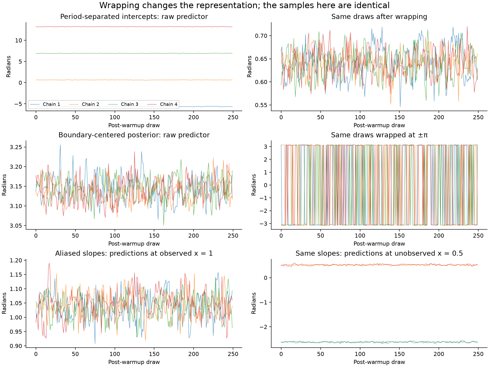

# Wrapping, sampling, and directional diagnostics

- **What we tested:** `identity` versus `wrap` in 24 fits covering regression
  across multiple turns, intercepts separated by whole turns, a posterior near
  ±π, and different slopes with matching predictions at observed values.
- **Why:** To distinguish better sampling from better representation of the
  same direction, using matched data, priors, initial values, and random seeds.
- **What happened:** Sampling was essentially identical, with zero divergences
  and matching NUTS step counts. For directions stored in different periods,
  wrapping changed R-hat from about 2.84 to 1.00 on the same draws.
- **What to do:** Use `wrap` for directional predictions in `[-pi, pi)` and
  comparable traces across periods. Check both sine and cosine near the cut,
  and assess predictions at predictor values of interest. Keep diagnostics on
  real-valued coefficients too; wrapping a direction does not resolve distinct
  coefficient modes or make a slope an angle.

These findings use the original modulo implementation. The later roundoff
refinement is covered by focused tests, not a repeat of the 24-fit experiment.



R-hat medians and min–max ranges across three seeds use the same draws from
identity fits (left). Disagreement remains at new predictor values. All 12
matched fit pairs took identical post-warmup NUTS steps (right).

## Experiment design

[wrap_validation.py](../../notebooks/wrap_validation.py) runs four Bambi models
with both links and three data seeds: **24 fits, 96 chains, and 96,000 retained
draws**. Each fit uses four sequential PyMC NUTS chains, 750 warmup iterations,
1,000 retained draws per chain, `target_accept=0.9`, and `init="adapt_diag"`.
Each pair has identical data, explicit priors, initial values, and random seed.
All observations are in radians, and concentration is fixed at 8 to isolate the
effect of wrapping the mean. Predictor centering is disabled.

| Scenario | Model and priors | Initialization and purpose |
| --- | --- | --- |
| Regression crossing multiple cuts | 160 observations; `y ~ x`, x evenly spaced in [-3, 3]; true intercept 0.4 and slope 2; Normal priors centered at those values with SD 0.5 | Four nearby but distinct starts; tests continuous predictors spanning multiple turns |
| Intercepts separated by full turns | 160 observations; `y ~ 1`; true direction 0.6; intercept Normal(0, 20) | Starts at 0.6 + 2πk for k = -1, 0, 1, 2; tests agreement about the same direction across periods |
| Posterior centered on the cut | 160 observations; `y ~ 1`; intercept Normal(π, 0.5) | Paired angular errors center the data exactly at π; starts on both sides of π |
| Aliased slopes | 160 observations at x = 0 or 1; `y ~ 0 + x`; true slope 1; slope Normal(0, 20) | Starts at 1 + 2πk; evaluates predictions at observed x = 1 and unobserved x = 0.5 |

The recorded environment is PyMC 6.3.2, PyTensor 3.3.4, ArviZ Stats 1.3.3,
NumPy 2.5.4, and the Bambi branch implementing `wrap`. Diagnostics use
rank-normalized split R-hat and bulk ESS. Full results, per-coordinate diagnostics,
versions, seeds, and computational measurements are in [results.json](results.json).
These numerical results record the original modulo implementation. A later
roundoff correction preserves angles already in the principal interval exactly
and maps any rounded upper endpoint back to `-pi`. Focused NumPy/PyTensor tests
cover those changes; the 24-fit study has not been repeated for that correction.

## Directional diagnostics improve when whole-turn offsets are irrelevant

The table reports ranges across the three data seeds. Both columns use the
**same posterior draws from the identity fit**; the second applies wrapping
after sampling. The `wrap` fits reproduce these results to numerical precision.

| Quantity assessed | R-hat on raw predictor | R-hat after wrapping |
| --- | ---: | ---: |
| Mean direction, chains separated by full turns | 2.840–2.843 | 1.001–1.002 |
| Mean direction centered on ±π | 1.002–1.002 | 1.000–1.002 |
| Aliased slope predictions at observed x = 1 | 2.842–2.846 | 1.001–1.002 |
| Aliased slope predictions at unobserved x = 0.5 | 2.842–2.846 | 1.735–1.736 |

For the period-separated intercepts, bulk ESS changes from about 4.63 for the
unwrapped predictor to 1,397–1,476 for the wrapped direction. Diagnostics on
both sine and cosine agree with the wrapped-direction result. This change
reflects the quantity being assessed; sampling has not become more efficient.

An independent-draw control removes MCMC from the comparison entirely. Four
sets of 4,000 independent Normal(0.6, 0.03) draws receive different fixed
whole-turn offsets. Raw R-hat is 2.839 and raw ESS is 4.59; after wrapping,
R-hat is 0.99996 and ESS is 15,763. The chains were sampling the same angular
distribution throughout. Raw diagnostics were assessing a real-valued
representation containing arbitrary period offsets.

In the fitted intercept example, the real-valued intercept chains remain in
different modes under the deliberately broad Normal prior. Its raw R-hat
correctly describes that real-valued parameter. For the physical direction,
the wrapped representation is the relevant one. The independent-draw control
demonstrates this distinction without any approximation about the prior.



## The sampler sees the same posterior in these comparisons

PyMC's von Mises log density depends on the mean through `cos(mu - y)`, so
replacing a predictor with its wrapped value leaves the likelihood unchanged
in exact arithmetic. Using the same coefficient priors preserves the posterior.
The wrapped angle jumps at the cut, but its composition with this periodic
likelihood is smooth.

Across actual compiled Bambi graphs, joint log-density differences were at
most 1.14e-13 and gradient differences at most 1.52e-12 at the evaluated
points, including points near the cut. Across all twelve fit pairs:

- Every pair had exactly the same total number of retained NUTS steps.
- The largest coefficient-draw difference was 8.14e-14 radians.
- The largest angular-prediction draw difference was 2.00e-13 radians.
- All 24 fits had zero divergences.

These small controlled models show a diagnostic and presentation benefit,
with no measurable sampling benefit. They are not an exhaustive benchmark of
hierarchical circular models, alternative samplers, or historical versions.
Recorded wall times include compilation and are not used as a speed comparison.

## A fixed cut still requires circular summaries

For the posterior centered on π, both raw and wrapped diagnostics were good.
Wrapping made the trace alternate between values near +π and -π, as expected.
The ordinary mean of the wrapped draws was 0.009–0.037 radians, whereas the
circular mean was within 0.0007 radians of π. This is the familiar limitation of
ordinary arithmetic on angles, not evidence of poor sampling.

For a direction, inspect both `sin(mu)` and `cos(mu)` and use circular means
and intervals. For a concentrated unimodal posterior, another useful view is
`wrap(mu - reference)`, with one common reference direction for every chain;
this places the cut away from the posterior mass. The script also records this
diagnostic using the pooled circular mean as the common reference. These views
complement each other; none alone proves convergence for every possible
circular distribution.

The slope example illustrates why the scientific quantity matters. A change
of 2π in a slope gives the same direction at x = 1, but changes the direction
by π at x = 0.5. Wrapped diagnostics correctly show agreement at the observed
point and disagreement at the intermediate prediction point. Thus evaluating
directional diagnostics at the predictor values of interest is useful, and
slope coefficients should not automatically be treated as angles modulo 2π.
The link wraps the resulting mean direction, leaving coefficients intact.

## Numerical stress and historical behavior

A separate float64 check compares PyMC likelihoods and gradients against an
80-digit mpmath reference for predictors ranging from 0.1 to 1e16 radians.
Both methods are accurate at ordinary predictor magnitudes. At 1e9 radians,
wrapping reduces the tested log-density error from 3.37e-8 to 1.02e-8; at
1e12 it increases the error from 1.70e-4 to 3.34e-4. Neither method is uniformly
better at extreme magnitudes, where floating-point argument reduction matters.
These are stress points, not realistic regression settings or a reason to
expect a general numerical-stability improvement.

The cosine-based likelihood is present in both
[PyMC 5.10.1](https://www.pymc.io/projects/docs/en/v5.10.1/_modules/pymc/distributions/continuous.html#VonMises)
and the tested PyMC 6.3.2. This source comparison does not identify a recent
fix explaining a past difference. Reproducing a historical sampling change
would require its model, data, and dependency versions.

For Bambi, `wrap` makes directional predictions and diagnostics use a
consistent angular representation automatically. Postprocessing identity-link
draws provides the same directional benefit; the link makes that convention
part of model specification and prediction.

## Reproduce

Redraw the compact summary from saved results without sampling:

```bash
python docs/notebooks/plot_wrap_summary.py
```

This needs only NumPy and Matplotlib. Add `--preview path.png` for a PNG copy.

Install the branch and mpmath, then run from the repository root:

```bash
python docs/notebooks/wrap_validation.py --output docs/validation/wrap
```

This regenerates the JSON results and figure with the installed Bambi version;
it leaves this report and its summary intact. Review the recorded numbers before
updating the report after a new run. It is a simulation study rather than a CI
test; no assertion requires a particular stochastic R-hat value.

Diagnostic definition: [ArviZ Stats R-hat documentation](https://python.arviz.org/projects/stats/en/stable/api/generated/arviz_stats.rhat.html).
